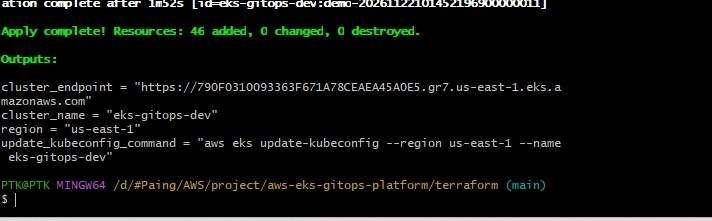
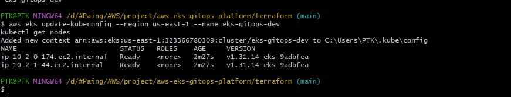
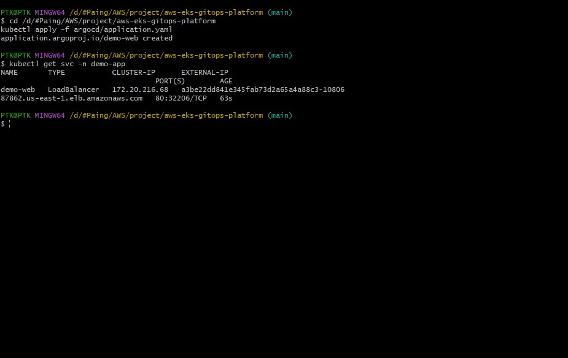
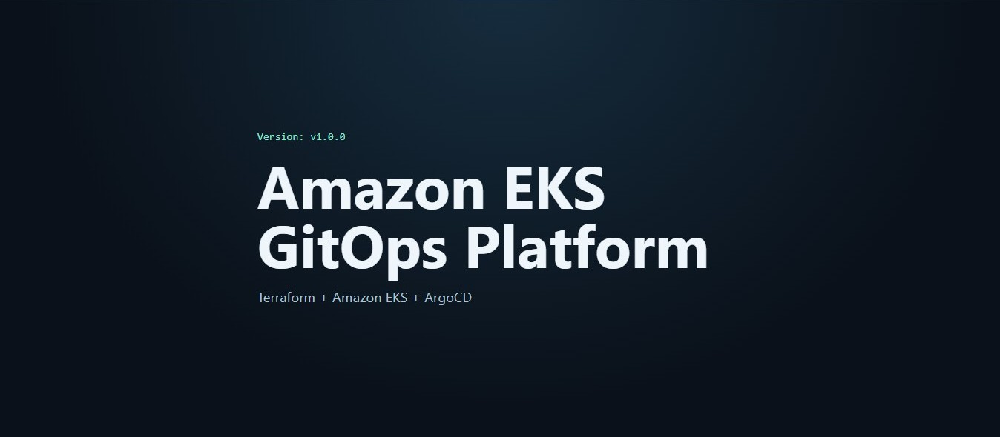
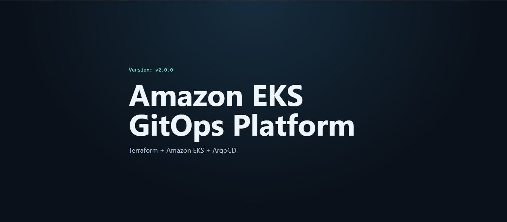
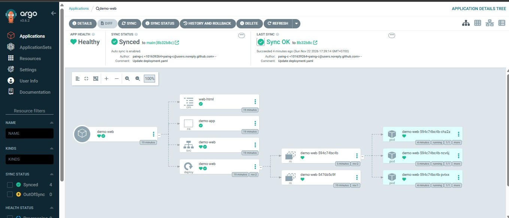
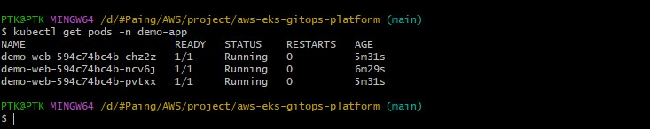
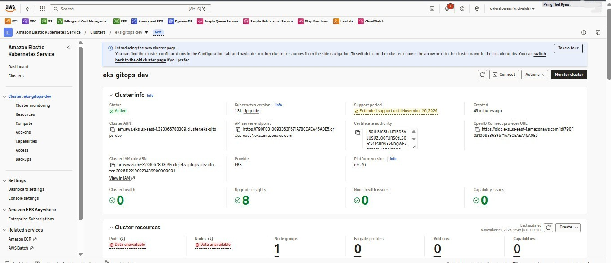
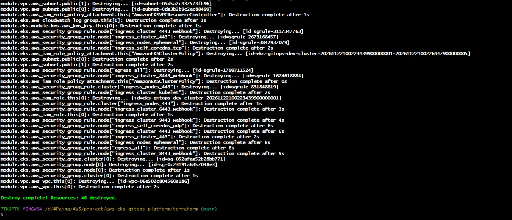

# Amazon EKS + Argo CD GitOps Platform

Terraform provisions a two-AZ Amazon EKS environment in `us-east-1`. Argo CD reconciles a versioned Nginx demo from GitHub, and an AWS load balancer exposes the app over HTTP. The recorded demo covers provisioning, a Git-driven release, replica scaling, drift recovery, and teardown.

## Architecture

```text
Developer
    |
    | git push / merge to main
    v
GitHub: paing-c/aws-eks-gitops-platform
    |-- terraform/  VPC and EKS infrastructure
    |-- k8s/        desired application state
    `-- argocd/     Application definition
    |
    | Argo CD watches main:k8s/
    v
Argo CD (auto-sync, prune, self-heal)
    |
    | reconciles workloads in demo-app
    v
Amazon EKS: eks-gitops-dev (Kubernetes 1.31)
    |  2 x t3.medium On-Demand nodes in public subnets
    |  us-east-1a and us-east-1b
    v
AWS Load Balancer (ELB) <- Kubernetes LoadBalancer Service :80
    |
    v
Live Nginx web app
```

The operator runs Terraform to provision EKS and bootstraps Argo CD on that same cluster. Argo CD then manages the workload manifests under `k8s/`.

## Key engineering highlights

- **Modular infrastructure as code.** The recorded Terraform apply provisioned 46 AWS resources using `terraform-aws-modules/vpc/aws` and `terraform-aws-modules/eks/aws`. [Terraform apply evidence](#01--terraform-apply)
- **Cost-conscious networking.** Two public subnets spread the node group across Availability Zones. Setting `enable_nat_gateway = false` eliminates NAT gateway charges, while the `kubernetes.io/role/elb = 1` subnet tag supports public load balancer discovery. The EKS control plane, worker nodes, storage, public IPv4 addresses, and load balancer still incur charges. [Amazon EKS pricing](https://aws.amazon.com/eks/pricing/)
- **Declarative delivery.** Argo CD tracks `main:k8s/`, automatically applies Git changes, prunes deleted resources with `prune: true`, and restores drifted resources with `selfHeal: true`.
- **End-to-end verification.** The demo progressed from `v1.0.0` to `v2.0.0`, scaled from two to three replicas through Git, and recovered to three running pods after a manual scale-down to one. The version change updates the mounted ConfigMap and reaches the running pods after Kubernetes propagates it. [Proof of work](#proof-of-work)

## Project structure

| Path | Contents |
| --- | --- |
| `terraform/` | VPC, EKS cluster and managed node group, provider lock file, and outputs |
| `k8s/` | `demo-app` namespace, HTML ConfigMap, Nginx Deployment, and public Service |
| `argocd/application.yaml` | Git source, EKS destination, and automated sync policy |
| `screenshots/` | Evidence from the recorded deployment and teardown |

## Step-by-step guide

### 1. Prepare your environment

Install Terraform, the AWS CLI (`aws`), and `kubectl`. Use AWS credentials with permissions to provision the stack and manage the EKS cluster. Run Terraform and configure kubeconfig using the same IAM identity so the module's cluster creator admin access applies. The commands use a Bash-compatible shell.

```bash
terraform version
aws --version
kubectl version --client
aws sts get-caller-identity
```

The demo pins Kubernetes 1.31. AWS lists November 26, 2026 as the end of its extended support. Check available versions before provisioning and update `cluster_version` in `terraform/eks.tf` to a supported version if needed. [Amazon EKS version lifecycle](https://docs.aws.amazon.com/eks/latest/userguide/kubernetes-versions.html)

### 2. Provision EKS

From the repository root, initialize Terraform and review the plan. Applying the stack creates billable AWS resources.

```bash
cd terraform
terraform init
terraform plan
terraform apply

aws eks update-kubeconfig --region us-east-1 --name eks-gitops-dev
kubectl get nodes
cd ..
```

Wait for both worker nodes to report `Ready`. Terraform also prints the kubeconfig command in the `update_kubeconfig_command` output.

### 3. Install Argo CD and sync the app

Install the version shown in the demo, then wait for the API server. [Argo CD installation guide](https://argo-cd.readthedocs.io/en/stable/getting_started/)

```bash
kubectl create namespace argocd
kubectl apply -n argocd --server-side --force-conflicts \
  -f https://raw.githubusercontent.com/argoproj/argo-cd/v3.6.2/manifests/install.yaml
kubectl -n argocd rollout status deployment/argocd-server --timeout=5m
```

If using a fork, update `spec.source.repoURL` in `argocd/application.yaml` to point to your fork and make sure `k8s/` is on its `main` branch. From the repository root, apply the Application and start the port-forward.

```bash
kubectl apply -f argocd/application.yaml
kubectl -n argocd port-forward svc/argocd-server 8080:443
```

Open `https://localhost:8080` and sign in as `admin`. Retrieve the initial password in a second terminal.

```bash
kubectl -n argocd get secret argocd-initial-admin-secret \
  -o jsonpath='{.data.password}' | base64 --decode
printf '\n'
```

### 4. Verify auto-sync and self-healing

Check for `Synced` and `Healthy` in Argo CD. Wait for the Service to show an external DNS name, then open it over HTTP or check the version with `curl`.

```bash
kubectl -n argocd get application demo-web
kubectl -n demo-app rollout status deployment/demo-web
kubectl -n demo-app get svc demo-web --watch
```

Stop the watch with `Ctrl+C` once the hostname appears.

```bash
ELB_HOST=$(kubectl -n demo-app get svc demo-web \
  -o jsonpath='{.status.loadBalancer.ingress[0].hostname}')
curl -fsS "http://${ELB_HOST}/" | grep 'Version:'
```

The current manifests start at `v2.0.0` and three replicas. To replay the recorded transition in your fork, first set `Version: v1.0.0` in `k8s/configmap.yaml` and `spec.replicas: 2` in `k8s/deployment.yaml`, push to `main`, and wait for sync. Then change the version to `v2.0.0` and replicas to `3` and push the changes to `main`. Argo CD applies both changes automatically.

```bash
kubectl -n argocd get application demo-web --watch
```

Once Argo CD shows the new commit as synced, stop the watch and verify the result. Allow time for the mounted ConfigMap to refresh if the endpoint still returns the old version.

```bash
kubectl -n demo-app rollout status deployment/demo-web
kubectl -n demo-app get deployment demo-web
curl -fsS "http://${ELB_HOST}/" | grep 'Version: v2.0.0'
```

With Git still declaring three replicas, manually scale the live Deployment to one. Watch the Deployment return to three ready replicas as Argo CD reconciles the drift.

```bash
kubectl -n demo-app scale deployment/demo-web --replicas=1
kubectl -n demo-app get deployment demo-web --watch
```

### 5. Tear down safely

Record the load balancer hostname while the Service exists. Delete the Argo CD Application to stop reconciliation, then delete the workload namespace while EKS is still running so AWS can remove the Service's load balancer.

```bash
ELB_HOST=$(kubectl -n demo-app get svc demo-web \
  -o jsonpath='{.status.loadBalancer.ingress[0].hostname}')
printf '%s\n' "$ELB_HOST"

kubectl delete -f argocd/application.yaml --wait=true
kubectl delete namespace demo-app --wait=true
```

Check the EC2 Load Balancers console in `us-east-1` and wait until the load balancer matching the recorded hostname is gone. Then review and confirm Terraform's destroy plan.

```bash
cd terraform
terraform destroy
```

## Proof of work

### 01 · Terraform apply



Terraform provisioned 46 resources and printed the cluster connection details.

### 02 · EKS nodes ready



Both managed worker nodes joined the cluster and reported `Ready`.

### 03 · Argo CD Application and Service



The Application synced the workload, and the Service received an AWS ELB hostname.

### 04 · App v1.0.0



The public endpoint served the initial release.

### 05 · App v2.0.0



The same endpoint served the updated release after Git sync.

### 06 · Argo CD resource tree



Argo CD showed a healthy sync to `main` with three running pods.

### 07 · Self-healing



Three pods were running again after the manual scale-down.

### 08 · AWS EKS console



The AWS console showed `eks-gitops-dev` active in `us-east-1`.

### 09 · Terraform destroy



Terraform confirmed removal of all 46 resources it managed.
